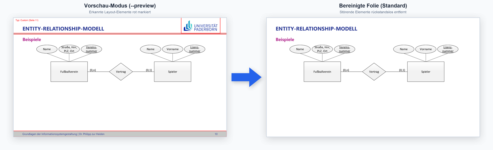

# upb-lecture-slide-declutterer

Python-Tool zum automatischen Entfernen wiederkehrender Design- und Layout-Elemente aus Vorlesungsfolien (PDF) der Universität Paderborn.



## Funktionen

- **UPB-Vorlagen-Erkennung:** Klassifiziert Folien anhand der Referenzvorlagen in `templates/` (z. B. *Title slide*, *Agenda*, *Separation page*, *Content*, *Contact*).
- **Custom-Template-Erkennung:** Erkennt auch auf abweichenden Lehrstuhl-Vorlagen automatisch sich wiederholende Elemente über alle Seiten hinweg.
- **Gezielte Bereinigung:** Entfernt UPB- und Lehrstuhl-Logos, farbige Deko-Dreiecke, Kopf-/Fußzeilenbalken, Hintergrund-Wasserzeichen, Fußzeilentexte sowie Foliennummern, ohne den eigentlichen Folieninhalt zu beschädigen.

## Voraussetzungen & Installation

```bash
python3 -m venv .venv
source .venv/bin/activate
pip install pymupdf pillow numpy
```

## Verwendung

### 1. Einzelne PDF-Datei bereinigen

```bash
python clean_slides.py -i datei.pdf
```
Speichert die bereinigte Datei standardmäßig unter `clean/clean_datei.pdf`.

### 2. Ganzen Ordner bereinigen

```bash
python clean_slides.py -i pfad/zum/ordner
```
Verarbeitet alle PDFs im Ordner und legt die Ergebnisse in `pfad/zum/ordner/clean/` ab.

### 3. Vorschau-Modus (rote Markierungsrahmen statt Löschen)

```bash
python clean_slides.py -i datei.pdf --preview
```
Erzeugt eine Prüfdatei mit eingezeichneten Redaction-Bereichen und erkanntem Folientyp unter `preview/preview_datei.pdf`.

## Optionen

| Parameter | Beschreibung |
| :--- | :--- |
| `-i`, `--input` | Pfad zu einer einzelnen PDF-Datei oder einem Ordner mit PDFs |
| `-o`, `--output` | Optionaler Ausgabepfad (Datei oder Ordner). Standard: Unterordner `clean/` bzw. `preview/` |
| `--preview` | Zeichnet die erkannten Löschbereiche als rote Rahmen ein, ohne Inhalte zu entfernen |
| `--keep-slide-numbers` | Behält die Foliennummern auf den Folien bei |
| `--keep-footer-text` | Behält den Fußzeilentext (Veranstaltung, Dozent, Semester) bei |

## macOS Quick Action im Finder

 
Um Folien oder ganze Ordner direkt per Rechtsklick als **Quick Action** im Finder zu bereinigen, erstelle einen Kurzbefehl in der Kurzbefehle-App:

### Variante 1: Automatische Installation
1. Verschiebe den Ordner `upb-lecture-slide-declutterer` nach `Dokumente`.
2. Installiere den Kurzbefehl: https://www.icloud.com/shortcuts/830ef2e29bb1473b88773c481724f62d

### Variante 2: Manuelles Anlegen 

1. **Kurzbefehle-App** öffnen und auf **+** (Neuer Kurzbefehl) klicken.
2. Kurzbefehl benennen (z. B. `PDF Folien säubern`).
3. Rechts in der Seitenleiste auf das **Info-Symbol** klicken und **Als Schnellaktion verwenden** -> **Finder** aktivieren.
4. Im oberen Arbeitsbereich erscheint nun ein neuer Block. Dort als Kurzbefehleingabe die Eingabetypen **Ordner** und **PDFs** auswählen: `[Apps und 2 weitere] von [Schnellaktionen] erhalten. Wenn es keine Eingabe gibt: [Anfordern] [Dateien]`
5. Rechts nach der Aktion **„Shell-Skript ausführen“** suchen und hinzufügen.
6. Einstellungen der Aktion:
   * **Shell:** `[zsh]`
   * **Eingabe übergeben:** `[als Argumente]`
7. Skriptinhalt einfügen (passe ggf. den Pfad zur Python-Datei an):
```zsh
cd "$HOME/Documents/upb-lecture-slide-declutterer/" || exit 1

for item in "$@"; do
    if [ -d "$item" ]; then
        # Objekt ist bereits ein Ordner: Ausgabe direkt in diesen Ordner
        out_dir="$item"
    else
        # Objekt ist eine Datei: Ausgabe in den Ordner der Datei
        out_dir="$(dirname "$item")"
    fi

    ./.venv/bin/python3 clean_slides.py -i "$item" -o "$out_dir"
done
```